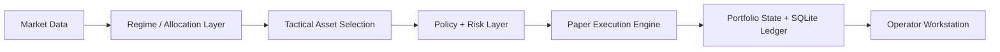

# Kraken Interface Workstation

Kraken Interface is a full-stack trading workstation for AI-assisted paper trading and portfolio control. The system combines live Kraken market reads, a packaged GRU-based tactical signal engine, explicit policy and risk layers, a paper execution engine, a SQLite experiment ledger, and an operator-facing React/FastAPI interface.

The project is designed as an auditable decision-and-control system rather than a prediction demo. Market observation, signal generation, policy, risk, execution, accounting, and observability are kept as separate layers so behavior can be inspected and extended without rewriting the whole stack.

## System concept



## Core architecture

### 1. Market layer

- Live market snapshots and candle history come from Kraken through a read-only adapter path.
- The backend normalizes exchange data into stable API contracts for the UI and the engine.
- Mock-safe fallbacks remain available for development and failure handling.

### 2. Signal layer

- The packaged GRU runtime is artifact-aware and used as the active tactical engine when the packaged artifact is available.
- The GRU is best interpreted as a local regime or trend-confirmation engine, not a direct execution oracle.
- Signal output is separated from allocation policy, risk, and execution.

### 3. Policy and risk layer

- Asset and portfolio target weights are computed explicitly rather than treating signal output as a trade instruction.
- Risk rules apply spread checks, cooldowns, deadbands, caps, and other guardrails before execution.
- Cash is a first-class portfolio state, not an implicit leftover.

### 4. Execution and accounting layer

- The current engine is paper-only.
- Portfolio accounting is cash-and-quantity based, with portfolio value enforced from:
  - `cash_usd + sum(position_qty * latest_price)`
- Multi-asset positions, realized and unrealized PnL, and portfolio valuation are persisted each cycle.

### 5. Observability layer

- The system persists current state under `runtime_state/`.
- Historical engine cycles, signals, risk decisions, executions, and portfolio snapshots are written to a SQLite ledger.
- The workstation surfaces market state, engine state, portfolio composition, execution history, and chart views for active symbols.

## Key components

- `backend/`
  FastAPI backend, engine orchestration, adapters, services, schemas, and signal runtime.
- `frontend/`
  React/Vite workstation UI for market, engine, portfolio, history, and operator control.
- `library/`
  Reusable Python utilities, including the simplified LLM entry point.
- `artifacts/signal_engine/`
  Packaged signal-engine artifacts and artifact notes.
- `docs/`
  Architecture notes, operating notes, invariant tracking, and experiment/ledger documentation.
- `dev_mem/`
  Persistent project memory and module notes used to keep implementation state explicit.
- `trading_strategy_asset/`
  Strategy research notebook and related research asset history.

## Repository structure

```text
.
├── backend/                  # FastAPI app, services, adapters, schemas, signal runtime
├── frontend/                 # React/Vite workstation UI
├── library/                  # reusable Python helpers
├── artifacts/                # packaged signal-engine artifacts
├── docs/                     # architecture and operating notes
├── dev_mem/                  # persistent project memory
├── trading_strategy_asset/   # notebook-based research asset
├── scripts/                  # helper/export scripts
├── client.py                 # early Kraken CLI proof-of-concept
├── parser.py                 # early Kraken CLI proof-of-concept
├── schema.py                 # early Kraken CLI proof-of-concept
└── errors.py                 # early Kraken CLI proof-of-concept
```

## Local development

The standard local workflow is Docker-first.

### Start the stack

```bash
docker compose up --build
```

Typical service endpoints:

- Frontend: `http://<host>:5180`
- Backend API: `http://<host>:8002/api`

For direct non-Docker development:

```bash
uvicorn backend.app.main:app --reload
npm --prefix frontend run dev
```

### Development behavior

- The repository can be bind-mounted into containers for live development.
- `dev_mem/` and `library/` remain first-class workspace assets and are not hidden behind container-only state.
- Frontend dependencies are normally installed inside the frontend environment, not committed to source control.
- Runtime caches, local secrets, and generated build outputs are intentionally excluded from version control.

## Runtime and deployment notes

- Backend stack: Python + FastAPI
- Frontend stack: React + Vite
- Runtime mode today: paper trading only
- Market data path: Kraken live read path with mock-safe fallback
- Signal runtime: packaged GRU artifact path when available, with explicit status reporting
- Ledger: SQLite under `runtime_state/experiment_ledger.sqlite3`

The repository also includes deployment-oriented Docker files and compose files for containerized environments. Public deployment still requires explicit environment configuration, secrets injection, and infrastructure-level review.

## Current status

The current codebase includes:

- live Kraken market snapshot integration
- live candle history for charting
- packaged GRU tactical signal runtime
- explicit policy, risk, and rebalance flow
- paper execution engine with exact cash-and-quantity accounting
- multi-asset portfolio state
- SQLite experiment ledger
- resettable experiment boundary for trustworthy new runs
- operator workstation UI with market, engine, portfolio, history, and chart tabs

Current limits:

- no real-money execution
- no production-grade broker abstraction beyond the current Kraken-focused path
- some higher-level class-allocation ideas remain architectural work in progress
- research notebook lineage is still important for understanding signal intent

## Roadmap

Near-term priorities:

- continue improving tactical signal and allocation calibration
- extend portfolio intelligence without weakening accounting correctness
- improve experiment analytics and attribution from the SQLite ledger
- harden deployment and operating workflows

Longer-term directions:

- broader class-aware allocation hierarchy
- stronger regime separation between slow allocation and fast tactical selection
- longer forward-testing and evaluation windows
- eventual real-money readiness only after execution, funding, and controls are fully validated

## Security and secrets

- Do not commit secrets.
- Local secrets belong in `api_secret/` or environment variables, not in tracked source files.
- `.env.example` is a template only.
- Generated runtime state under `runtime_state/` is local operational state and is intentionally excluded from version control.
- Before making the repository public, review deployment files, notebooks, artifacts, and project-memory notes for anything that should remain private.
