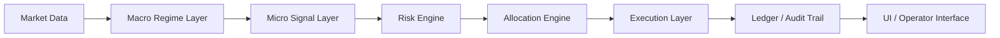
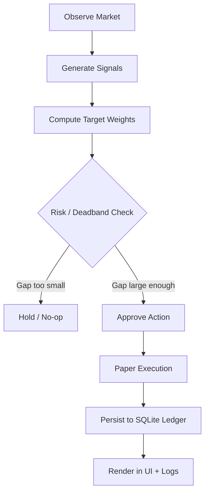
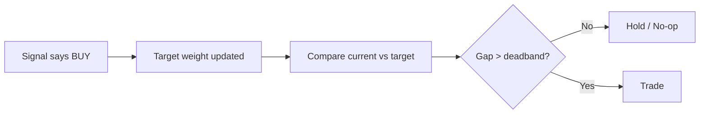

# Kraken Interface Workstation
### Autonomous AI Trading Agent for the **AI Trading Agents** Hackathon

<p align="center">
  
  
  
  
  
</p>

<p align="center">
  <b>Not a prediction demo. Not a toy bot.</b><br>
  A decision-and-control system for capital allocation under uncertainty.
</p>

---

## Why this project exists

This project was **not organized around winning the hackathon**. It was used as a capacity test:

> Can a small team build a credible autonomous financial system that observes markets, distinguishes signal from noise, adapts to regime changes, enforces risk, executes decisions, and explains itself under real constraints?

That means the real target was never “show a flashy chart in a few hours.”  
The target was to build a system that could survive contact with reality.

---

## What we built

Kraken Interface Workstation is a full-stack trading decision pipeline with:

- **Market observation**
- **Regime-aware signal extraction**
- **Risk-constrained portfolio allocation**
- **Action mapping**
- **Execution layer**
- **Persistent audit trail**
- **Cloud deployment**
- **Operator-facing interface**

---

## Landing-page snapshot

### System concept



### Runtime decision loop



---

## Architecture

### 1) Macro layer: regime-aware allocation
The macro layer decides **which asset classes deserve capital**.

Inputs include:

- momentum
- volatility-adjusted momentum
- relative strength
- drawdown
- persistence / confidence

Output:

- class-level allocation weights

### 2) Micro layer: GRU + MACD asset selection
The micro layer decides **which assets inside the class deserve more weight**.

Inputs include:

- GRU forecast strength
- MACD trend confirmation
- volatility penalty
- confidence weighting

Output:

- intra-class target weights

### 3) Execution and audit layer
The system maps target weights into concrete actions:

- increase
- reduce
- hold
- flatten

All decisions are persisted into a ledger for:

- traceability
- review
- debugging
- post-run assessment

---

## Key innovation: **Autocoda**

A major internal achievement in this project was **Autocoda**, an agentic auto-coding workflow used to accelerate design and iteration.

Instead of manually inching through every change, Autocoda was used to:

- evolve the GRU-MACD logic iteratively
- accelerate system integration
- reduce coding bottlenecks near deadline
- turn architectural intent into working modules faster

> We did not just build a trading agent.  
> We also proved a workflow for building trading agents faster.

This is one of the biggest contrasts with prior competition experience: the bottleneck this time was **not coding stagnation**.

---

## Verifiable system behavior: 8-hour live run

_All metrics below are derived from SQL queries against the runtime SQLite ledger._

### Execution summary

| Metric | Value |
|---|---:|
| Filled executions | 41 |
| No-op decisions | 1318 |
| Buy orders | 21 |
| Sell orders | 20 |
| Average execution size | 0.0058283 |
| Minimum execution size | 0.0 |
| Maximum execution size | 0.2276 |

### Signal summary

| Metric | Value |
|---|---:|
| Buy signals | 2001 |
| Hold signals | 234 |
| Average confidence | 0.571642371364654 |
| Minimum confidence | 0.0003 |
| Maximum confidence | 0.8553 |

### Portfolio snapshot

| Metric | Value |
|---|---:|
| Latest portfolio value | 9954.05 |
| Initial capital baseline | 10000.00 |
| Realized PnL | 36.60 |
| Unrealized PnL | -11.88 |
| Approx. net PnL | -45.95 |
| Approx. return | -0.46% |

### Asset-level execution notional

| Symbol | Side | Trades | Total notional |
|---|---|---:|---:|
| ADAUSD | buy | 9 | 17974.72 |
| ADAUSD | sell | 9 | 17940.04 |
| SOLUSD | buy | 7 | 13954.08 |
| SOLUSD | sell | 6 | 11972.44 |
| AVAXUSD | buy | 3 | 6011.91 |
| AVAXUSD | sell | 3 | 6001.40 |
| ETHUSD | buy | 1 | 2276.00 |
| BTCUSD | buy | 1 | 2224.00 |
| BTCUSD | sell | 1 | 374.77 |
| ETHUSD | sell | 1 | 349.95 |

### What these numbers mean

- **High signal volume, low execution volume**  
  The system generates many opportunities, but the risk layer filters aggressively.

- **Balanced buy/sell profile**  
  21 buys vs 20 sells suggests no forced directional bias in a short noisy window.

- **Deadband-controlled restraint**  
  A large share of decisions resolve to no-op, meaning the portfolio is not churning for cosmetic activity.

- **Short-window realism**  
  An 8-hour run is too short to judge long-horizon edge in a double-regime architecture. A slight drawdown is normal and more credible than a suspiciously smooth short-term gain.

---

## Why the system looks conservative

The system uses a **deadband-constrained rebalancing rule**.  
In plain language:

- signals can say “buy”
- target weights can change
- but if the gap between current and target weight is too small, the system does **nothing**

That behavior is intentional.



This makes the system behave more like a **risk-aware allocator** than a hyperactive trading bot.

---

## Interface

The operator interface exposes:

- market data
- signal state
- portfolio state
- execution history
- backend status
- event log
- AI copilot panel

This is important because the project is not just a model.  
It is an **operable system**.

---

## Deployment status

### What is live
- cloud deployment
- live market observation
- paper execution engine
- ledger and UI
- runtime state persistence

### What was attempted
- real-fund transfer to Kraken
- live execution readiness

### What blocked real-money activation
- SWIFT transfer latency near deadline

This matters because the key constraint was **not engineering paralysis**.  
It was **capital arrival timing**.

---

## Project doctrine

This repository follows a very specific doctrine:

- build a **decision-and-control system**, not a prediction theater demo
- treat risk as primary
- accept that real systems are constrained by execution, funding, and timing
- prefer verifiable behavior over hype
- use the hackathon as a **capacity test**, not merely a leaderboard gamble

---

## Repo structure

```text
.
├── engine/          # core decision engine
├── models/          # GRU, indicators, scoring logic
├── execution/       # paper engine, Kraken integration
├── runtime/         # runtime state, ledger, snapshots
├── ui/              # operator-facing dashboard
├── docs/            # briefs, reports, methodology
└── scripts/         # setup, migration, operational helpers
```

---

## What was achieved

- working autonomous decision pipeline
- live cloud deployment
- explainable logs and SQL artifacts
- paper execution and portfolio tracking
- portfolio and risk logic
- operator-facing workstation UI
- faster iteration via Autocoda

---

## What remains

- full real-money execution validation
- longer-horizon performance evaluation
- stronger risk constraints
- refined allocation sensitivity
- more extensive backtesting and forward testing

---

## Honest conclusion

This repository demonstrates a **credible autonomous financial architecture**.

It does **not** claim that an 8-hour window proves alpha.  
It does claim that:

- the system works end to end
- the architecture is real
- the logs are verifiable
- the constraints encountered were real-world constraints

> We built a real system.  
> The hardest blocker near the deadline was not code. It was capital activation timing.

---

## Suggested screenshots

Add these files to the repo for maximum impact:

- `docs/images/workstation-overview.png`
- `docs/images/equity-trace.png`
- `docs/images/runtime-log.png`

Then insert them here:

```md


```

---

## License

Add your preferred license here.

## Team

Siam Intelligence Unit
